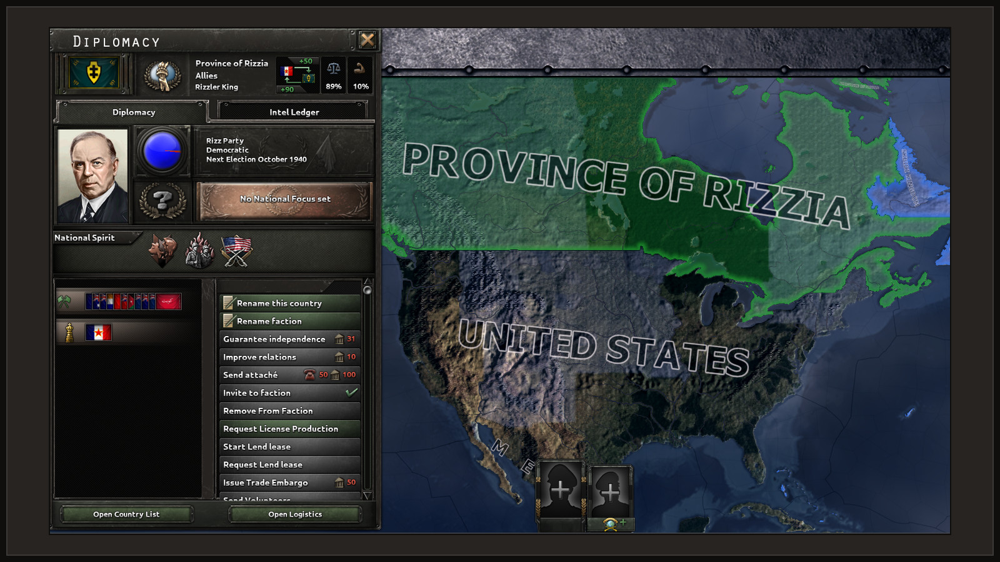
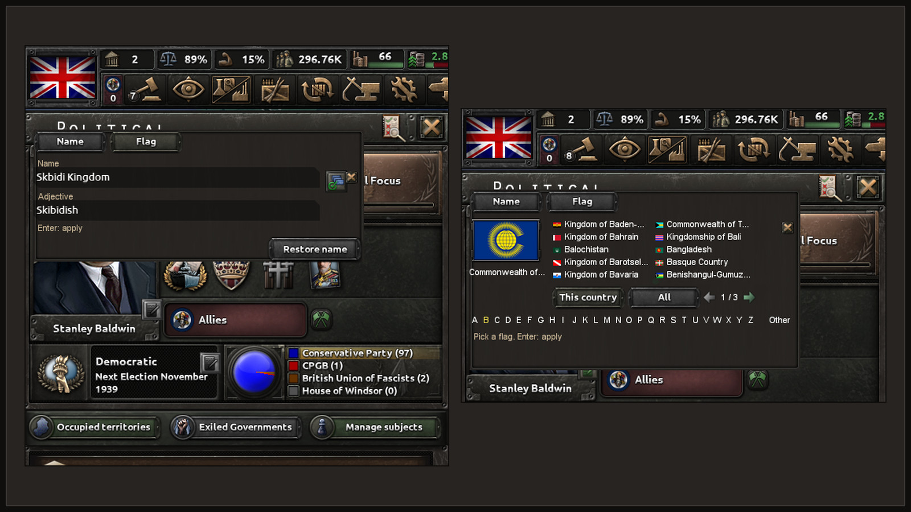
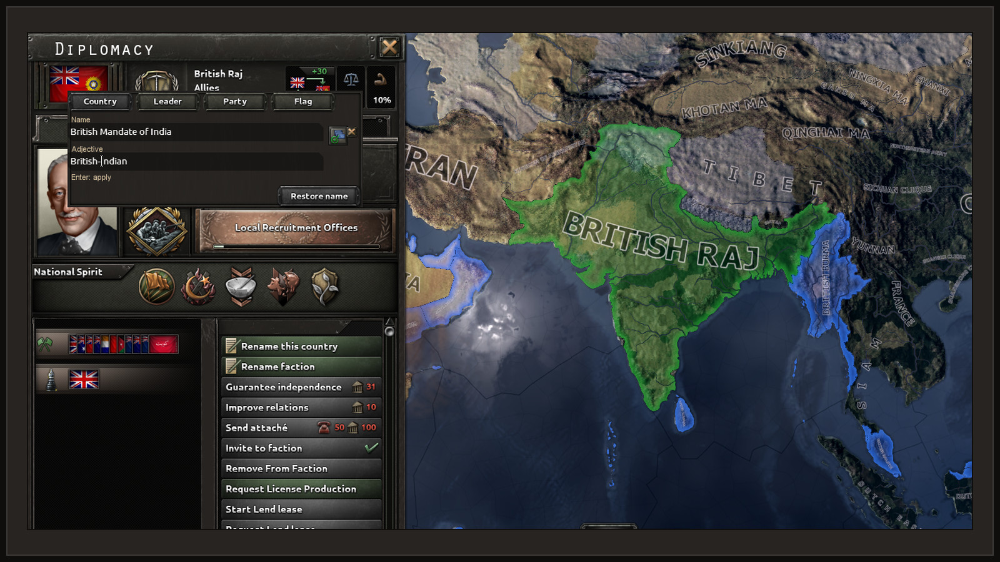
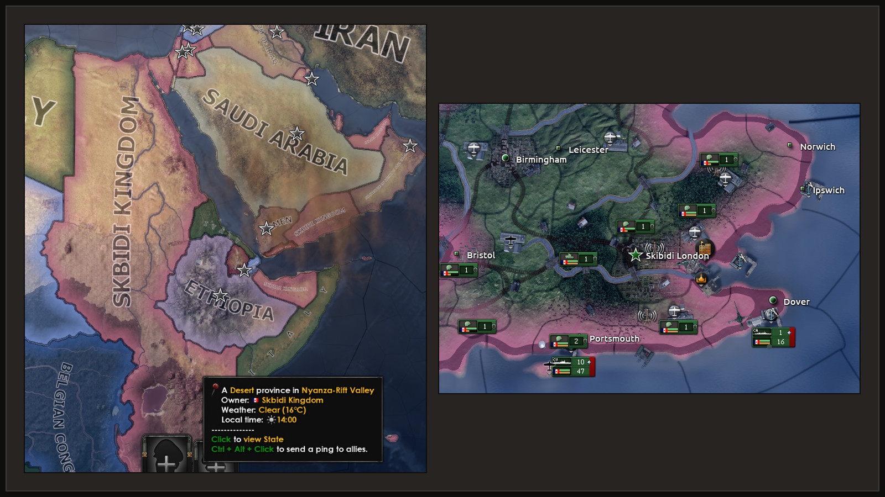

# Rename Anything


**Click the pencil next to a name, type a new one, press Enter.** Rename Anything lets you rename
your country, its leader, its parties, its states and its cities in Hearts of Iron IV, right in
the panel where the name is shown. It works the way the game already lets you rename divisions,
armies and fleets. As an overlord you can also rename your subjects.

Built on CAPIE (Cyprian's API Extender), a small native library that gives HOI4 mods abilities
the scripting language does not have.



> **Pre-release.** Nothing is published on the Workshop yet. Features marked "Works today" were
> checked in the game, in single player, on development builds. Multiplayer is not supported.

Polish: [Rename Anything po polsku](sites/rename-anything/docs/pl/index.md).

## Why

HOI4 lets you name a division whatever you like, but your own country, its leader and its ruling
party are stuck with whatever the game or a focus tree gives them. Existing Workshop mods get
around this with decisions that pick from prepared lists of names. Rename Anything gives you a
real text field instead: any name you can type, Polish letters included, saved in your campaign.

## In the game

Screenshots from HOI4 1.19.3.0 in single player, on development builds. The silly names are ours.

Your country's name and adjective go into the game's own text field. The flag can be any flag the game has.



To rename your leader, click the pencil by the portrait, type, press Enter.


An overlord renames a subject through the diplomatic action "Rename this country".



The leader of a faction renames it from Diplomacy.


With the news game rule on, every country gets a news event about the new name.


Map labels, tooltips and renamed cities show the new names.



## How it works


The mod is ordinary HOI4 script and interface files. It adds a pencil beside each name it can
change. Clicking it opens the game's own text field (`editBoxType`) in that spot, prefilled with
the current name. HOI4 scripts cannot read what you type into such a field, so CAPIE passes the
text to the mod through the same game command a button click sends. From there the mod uses the
game's own rename effects, and the result is written into your save like any other change.


States, cities and characters need nothing beyond the scripts. Your country's name and adjective
also need CAPIE, because the game has no script effect that takes free text for a country. The
name you give is stored in your save as its own layer, separate from the game's cosmetic tags, so
the flag and colour stay as they are. Without CAPIE the save still loads and the country shows
the name the game would give it.


CAPIE is loaded into the game by a small launcher that goes through the Paradox Launcher, so you
keep your playsets. It loads only on the exact game build it was tested on. The details are in
[architecture](docs/contributing/architecture.md).

## What works today

Checked in the game on HOI4 1.19.3.0 (Windows, Steam), single player, on development builds. The
[in-game test record](docs/contributing/in-game-test-record.md) lists the evidence and the limits
of every row.

| Feature | Status | Notes |
|---|---|---|
| Your country's name and adjective | Works today | Needs CAPIE. Flag and colour stay unchanged. Map, diplomacy, tooltips and events pick up the new name; decision titles keep their own text. |
| Your country's leader | Works today | Pencil next to the portrait in the Politics panel. The caption updates at once with CAPIE. |
| Ruling party name, short and full | Works today | |
| Other party groups through tabs | In progress | Two of the four groups were checked in the game. |
| States and cities (victory points) | Works today | Scripts only, no CAPIE needed. |
| Generals, admirals, advisers | Works today | Through the name editor, no CAPIE needed. Uses the game's text field when CAPIE is loaded. |
| Your subjects' names, as overlord | Works today | Diplomatic action "Rename this country": name and adjective, leader, ruling party. Needs CAPIE. |
| Polish letters (ą ć ę ł ń ó ś ź ż) | Works today | Typing them into the field was checked on one keyboard layout. |
| Names survive save, load and a full restart | Works today | |
| Enter applies the change | Works today | |
| 5-day cooldown per object | Works today | The pencil greys out and its tooltip says when the next rename is possible. |
| Esc cancels the edit | In progress | Esc closes the Politics panel and the editor with it, but the edit mode stays on. |
| "Restore name" button | In progress | Goes back to the game's name; uses the cooldown. Not yet checked in the game. |
| Game rules: who may rename, news event | In progress | Lobby rules. Not yet checked in the game. |
| Faction names | In progress | Needs CAPIE 1.4 (faction name layer). Checked once in the game on a developer build. |
| Choosing your own flag | In progress | Flag picker in the country and subject editors; needs CAPIE 1.4 (flag layer). Checked once in the game on a developer build. |
| Installer and the CAPIE switch in the playset | In progress | One-line PowerShell installer, a GitHub Releases installer, and a small "CAPIE" mod that switches CAPIE on. No release to install yet. |
| Main-menu line showing whether CAPIE is loaded | Planned | |
| Multiplayer | Not supported | Never tested with two players. |
| Achievements and ironman | Not supported | See [FAQ](#faq). |
| Any game version other than 1.19.3.0 | Not supported | CAPIE stays off; scripts keep working. |

## Safety

- **Original game files stay unchanged.** The launcher adds no file to the game folder. The
  alternative proxy loader adds one `version.dll` there, and its uninstall removes only the file
  it owns, after checking its hash. A foreign `version.dll` is never replaced.
- **No network.** CAPIE, the launcher and the proxy open no network connections. The installer
  goes online only when you ask it to install or update.
- **Pinned to one exact game build.** CAPIE checks the SHA-256 of `hoi4.exe` and the code it
  hooks. If anything differs it does not start and the game runs without it.
- **Fails closed.** Bad input (empty, too long, characters the game cannot show) is rejected and
  nothing changes.
- **Scanned before release.** Every published binary will be scanned on VirusTotal and the results
  linked from the release notes. There is no release yet, so there are no links yet.
- **Open source.** You can read and build everything in this repository.

## Install

### With the first release (in progress)

1. Subscribe to Rename Anything and to the small "CAPIE" mod on the Steam Workshop and add both to
   a playset.
2. Install CAPIE once, either with one PowerShell line (`irm ... | iex`, with a terminal UI) or
   with the installer from GitHub Releases.
3. Play as usual. CAPIE loads only while the "CAPIE" mod is enabled in the playset; disable it
   and the game starts clean. The installer can also switch CAPIE off and uninstall it.

The command and the release will be published together. Until then the installer refuses to run
on purpose. Its options are in [tools/bootstrap/README.md](tools/bootstrap/README.md).

### Today (development builds)

For testers comfortable with a developer setup.

1. Keep the whole `mod/` folder of this repository, for example
   `C:/Users/you/Documents/GitHub/hoi4-rename-anything/mod`.
2. In your HOI4 user folder (`Documents/Paradox Interactive/Hearts of Iron IV/mod/`) create
   `rename_anything_dev.mod`. The `path` must point at the `mod` subfolder that contains
   `common/`, `interface/` and `descriptor.mod`:

   ```text
   name="Rename Anything (dev)"
   path="C:/Users/you/Documents/GitHub/hoi4-rename-anything/mod"
   version="0.1.0"
   supported_version="1.19.*"
   ```

3. Add the mod to a playset in the Paradox Launcher. You do not need to change
   `dlc_load.json` or any game file.
4. For the features that need CAPIE, build it and load it into the running game as described in
   [plugin/capie/README.md](plugin/capie/README.md). This is a manual developer step and has to be
   repeated every time the game starts.

`supported_version="1.19.*"` only quiets the launcher's warning. Only 1.19.3.0 was tested.

## Roadmap

1. Check the restore button, the game rules, the news event and faction names in the game.
2. Release CAPIE 1.2 with the country name layer, then the faction name layer.
3. Move Rename Anything onto CAPIE's public editor contract.
4. Split the repository in two, keeping history: CAPIE (native library, launcher, installer) and
   Rename Anything (mod and tools). The design system is shared.
5. First public release: Workshop items, signed release files, VirusTotal links.
6. Multiplayer testing with two players.

The decisions behind this order are in the [decision records](docs/adr/README.md).

## For modders: CAPIE

CAPIE is meant to be a shared library any HOI4 mod can build on. Its script contract is plain
HOI4 script: a mod names its editor GUI by a fixed grammar, CAPIE adds the typed text to the
Apply command as temporary variables, and the mod's effect reads them. A mod written this way
parses and runs the same with or without CAPIE; only the branch it takes differs.

- [CONTRACT.md](plugin/capie/CONTRACT.md): API level 4. Text fields for any mod, status keys, the
  alphabet, error codes, permissions, the multiplayer handshake and the country name layer.
- [CAPIE script SDK](sdk/capie-script-sdk/README.md): ready-made effects for reading, checking
  and storing text, with a demo mod.
- [CAPIE site, for modders](sites/capie/docs/modders/index.md).

The public contract was checked in the game with the SDK's demo mod on CAPIE 1.1. CAPIE itself is
not released yet.

## FAQ

**Does it work in multiplayer?**
No. It has never been tested with two players, so it is not supported. The design keeps every
name in ordinary game state, but that is a design goal, not a test result. Switch CAPIE off
before you play multiplayer.

**Can I still get achievements?**
No. Any mod that changes files under `common/` changes the game's checksum, and achievements need
an unmodified checksum. Ironman was not tested.

**My antivirus complains.**
CAPIE loads itself into the game process, which is what some malware does too, so heuristic
warnings are possible. Every released binary will be scanned on VirusTotal and the results linked
from the release notes. The source is here; you can build it yourself.

**What happens after a game update?**
CAPIE is pinned to the exact HOI4 1.19.3.0 executable. After a patch the game starts without
CAPIE and you are told why. States, cities and characters still work through scripts; a custom
country name shows as the game's name until a CAPIE update supports the new version.

**How do I uninstall?**
Disable the mod in your playset and delete `rename_anything_dev.mod` (and the copied folder, if
you made one). Close the game to unload CAPIE. Nothing in the game folder needs repairing. Names
you set stay in the saves you made. To drop a custom country name from a save, use "Restore name"
in the game before you uninstall. Continuing an old save without the mod was not tested; try it
on a copy.

**Does it work with other mods?**
It should work with mods that leave the Politics panel and the state view alone. Mods that replace
`countrypoliticsview.gui` or the same scripted GUIs can conflict. Mods that change the map, state
or province IDs, or add victory points, need the city tables regenerated.

## Development

```powershell
uv sync
uv run python tools/gen.py      # regenerate the generated parts of mod/
uv run python tools/check.py    # static checks of mod/
uv run ruff check; uv run ty check; uv run pytest
```

Everything else (native builds, mutation tests, the installer, the sites, testing in the game) is
in [building and testing](docs/contributing/building-and-testing.md). The full documentation index
is [docs/README.md](docs/README.md).

### Layout

`mod/` is the mod; `tools/` the generator, checks and installer; `plugin/capie/` CAPIE, its
launcher and proxy; `sdk/` the CAPIE script SDK; `sites/` the public documentation sites;
`probes/` and `plugin/probes/` research probes; `docs/` the project documentation, decision
records and the evidence archive; [`docs/design/`](docs/design/DESIGN-SYSTEM.md) the shared design
system and tokens that the diagrams are drawn from.

## License

The intended license is MIT. It is not in place yet: until a `LICENSE` file is added, all rights
are reserved.

## Credits

CAPIE uses [MinHook](https://github.com/TsudaKageyu/minhook) by Tsuda Kageyu, under the BSD
2-Clause license; see [plugin/LICENSE.MinHook.txt](plugin/LICENSE.MinHook.txt).

Hearts of Iron IV is a trademark of Paradox Interactive. This project is not affiliated with or
endorsed by Paradox Interactive.
