# Rename Anything


**Click the pencil next to a name, type a new one, press Enter.** Rename Anything lets you rename
your country, its leader, its parties, its states and its cities in Hearts of Iron IV, right in
the panel where the name is shown. It works the way the game already lets you rename divisions,
armies and fleets.

Built on CAPIE (Cyprian's API Extender), a small native library that gives HOI4 mods abilities
the scripting language does not have.

> **Pre-release.** Nothing here is published on the Workshop yet. The features marked
> "Works today" below were checked in the game on development builds. Multiplayer is not
> supported.

## Why

HOI4 lets you name a division whatever you like, but your own country, its leader and its ruling
party are stuck with whatever the game or a focus tree gives them. Existing Workshop mods get
around this with decisions that pick from prepared lists of names. Rename Anything gives you a
real text field instead: any name you can type, Polish letters included, saved in your campaign.

## How it works



The mod is ordinary HOI4 script and interface files. It adds a pencil beside each name it can
change. Clicking it opens the game's own text field (`editBoxType`) in that spot, prefilled with
the current name. HOI4 scripts cannot read what you type into such a field, so CAPIE passes the
text to the mod through the same game command a button click sends. From there the mod uses the
game's own rename effects, and the result is written into your save like any other change.


States, cities and characters need nothing beyond the scripts. Your country's name and adjective
also need CAPIE: the game has no script effect that takes free text for a country, so CAPIE
supplies the name and adjective when the game looks them up. The text itself is stored in the
save, in the game's cosmetic tag. Without CAPIE the save still loads and the country shows its
original name.



The planned way to start the game keeps your habits: you press Play in Steam (or use a desktop
shortcut), pick your playset in the Paradox Launcher, and play with your other mods. The CAPIE
launcher only adds one step in between, and loads CAPIE only into the game it started.

## What works today

Everything marked "Works today" was checked in the game on HOI4 1.19.3.0 (Windows, Steam),
single player, on development builds. The [test report](docs/test-report.md) has the details
and limits for every row.

| Feature | Status | Notes |
|---|---|---|
| Your country's name and adjective | Works today | Needs CAPIE. Map, diplomacy, tooltips and events pick up the new name; decision titles keep their own text. |
| Your country's leader | Works today | Pencil next to the portrait in the Politics panel. |
| Party names, short and full | Works today | Tested on the ruling party and on a party that is not in power. |
| All four party groups through tabs | Works today | A party that is not in power was renamed through its tab. |
| Party name updates in the panel right away | Works today | |
| States and cities (victory points) | Works today | Scripts only, no CAPIE needed. |
| Other characters (generals, admirals, advisers) | Works today | Through the scripted name editor, no CAPIE needed. |
| Polish letters (ą ć ę ł ń ó ś ź ż) | Works today | Names with Polish letters apply and persist. Typing them into the field was checked on one keyboard layout. |
| Names survive save, load and a full game restart | Works today | |
| Enter applies the change | Works today | Same game command as clicking Apply. |
| 5-day cooldown per object | Works today | The pencil greys out and its tooltip says when the next rename is possible. |
| Editors merged into the main mod | Works today | The in-game check ran on the merged `mod/`. |
| Leader name updates without reopening Politics | In progress | Today the leader's name changes after you close and reopen the panel. |
| Esc cancels the edit | In progress | Esc closes the Politics panel and the editor with it, but the edit mode stays on. |
| Renaming a subject's names (as overlord) | In progress | Placeholder, hidden. |
| Start through Steam launch options or a shortcut | In progress | Launcher built and reviewed, not yet tested end to end. |
| One-line PowerShell installer, updates, uninstall | In progress | Script and offline tests exist; no release to install yet. |
| CAPIE API for other mods | Planned | See [For modders](#for-modders-capie). |
| Multiplayer handshake that refuses players without CAPIE | Planned | |
| Main-menu line showing whether CAPIE is loaded | Planned | |
| Multiplayer | Not supported | Never tested with two players. |
| Achievements and ironman | Not supported | See [FAQ](#faq). |
| Any game version other than 1.19.3.0 | Not supported | CAPIE stays off; scripts keep working. |

## Safety

- **No game files are changed.** Not `hoi4.exe`, not `steam_api64.dll`, nothing in the game
  folder. CAPIE works in the game's memory while it runs and is gone when you close the game.
- **No network.** CAPIE does not use the network. Current builds import only `KERNEL32` and
  `bcrypt` (used for SHA-256 checks); no networking library is among their imports. The
  installer script goes online only when you ask it to install or update.
- **Pinned to one exact game build.** CAPIE checks the SHA-256 of `hoi4.exe` and the code it
  hooks. If anything differs it refuses to start and the game runs without it.
- **Fails closed.** Bad input (empty, too long, characters the game cannot show) is rejected and
  nothing changes.
- **Scanned before release.** Every published binary will be scanned on VirusTotal and the
  results linked from the release notes. There is no release yet, so there are no links yet.
- **Open source.** You can read and build everything in this repository.

## Install

### First release (coming)

The plan: subscribe on the Steam Workshop, then run one PowerShell line that installs the CAPIE
launcher and, if you agree, adds it to Steam's launch options or creates a shortcut. The command
will be published with the first release. Until then there is nothing to install this way, and
the installer refuses to run on purpose. Its design and options are in
[tools/bootstrap/README.md](tools/bootstrap/README.md).

### Today (development builds)

For testers comfortable with a developer setup.

1. Keep the whole `mod/` folder of this repository, for example
   `C:/Users/you/Documents/GitHub/hoi4-rename-anything/mod`.
2. In your HOI4 user folder (`Documents/Paradox Interactive/Hearts of Iron IV/mod/`) create
   `rename_anything_dev.mod`. The `path` must point at the `mod` subfolder that contains
   `common/`, `interface/` and `descriptor.mod`:

   ```text
   name="Rename Anything (dev)"
   path="C:/Users/you/Documents/GitHub/hoi4-rename-anything/mod"
   version="0.1.0"
   supported_version="1.19.*"
   ```

3. Add the mod to a playset in the Paradox Launcher. You do not need to change
   `dlc_load.json` or any game file.
4. For country names and the in-panel text fields, build CAPIE and load it into the running game
   as described in [plugin/README.md](plugin/README.md). This is a manual developer step for now,
   and it must be repeated every time the game starts. Current builds still use legacy file names
   (`rename_anything_*.dll`, `rename_anything_injector.exe`); they will be renamed to CAPIE in a
   separate step.

`supported_version="1.19.*"` only quiets the launcher's warning. It does not mean other 1.19
patches were tested.

## Roadmap

1. Check the merged editors in the game with CAPIE loaded, including the instant caption refresh.
2. Rename the binaries to CAPIE (`capie_*.dll`) with new hashes and reviews.
3. A versioned contract between CAPIE and the mods that use it; Rename Anything pins a CAPIE
   version.
4. Split the repository in two, keeping history: CAPIE (native library, launcher, installer) and
   Rename Anything (mod and tools). The design system in [docs/design/](docs/design/) is shared.
5. First public release: Workshop item, signed release files, VirusTotal links.
6. Multiplayer testing with two players.

## For modders: CAPIE

> **Planned.** None of this exists yet. The names and syntax below are a proposal and will change.

CAPIE is meant to become a shared library any HOI4 mod can build on. The first goal is to expose
what Rename Anything already does inside the game: free text names for countries, leaders and
parties, plus a reliable way for a mod to know whether CAPIE is loaded and which version it is.

Illustrative only, **proposed syntax, subject to change**:

```text
# Proposed syntax, subject to change. Nothing below works today.
my_mod_rename_country = {
    if = {
        limit = { capie_loaded = { min_version = 1.0 } }
        set_custom_country_name = {
            name = "Nowa Polska"
            adjective = "nowopolski"
        }
    }
}
```

What is decided so far ([API decisions](docs/API-DECISIONS.md)):

- Both new script keywords and a variable-based protocol, whichever proves more stable across
  game patches.
- Every mod built on CAPIE ships a small snippet that shows a discreet main-menu line when the mod
  is enabled but CAPIE is missing.
- Versioned API with safe fallback for mods by other authors; data from other mods is validated.
- In multiplayer, CAPIE would check the other players and refuse those without it or with an
  incompatible version.
- Players rename only their own country's things. Exceptions: the host, and an overlord whose
  subject is another player.

## FAQ

**Does it work in multiplayer?**
No. It has never been tested with two players, so it is not supported. Script-only renames are
designed to travel as normal game commands, but that is a design goal, not a test result. Remove
CAPIE from Steam's launch options before you play multiplayer.

**Can I still get achievements?**
No. Any mod that changes files under `common/` changes the game's checksum, and achievements need
an unmodified checksum. Ironman was not tested.

**My antivirus complains.**
CAPIE loads itself into the game process, which is what some malware does too, so heuristic
warnings are possible. Every released binary will be scanned on VirusTotal and the results linked
from the release notes. The source is here; you can build it yourself.

**What happens after a game update?**
CAPIE is pinned to the exact HOI4 1.19.3.0 executable. After a patch the launcher starts the game
without CAPIE and tells you why. States, cities and characters still work through scripts; a
custom country name shows as the original until a CAPIE update ships for the new version.

**How do I uninstall?**
Disable the mod in your playset and delete `rename_anything_dev.mod` (and the copied folder, if
you made one). Close the game to unload CAPIE. Nothing in the game folder needs repairing. Names
you set stay in the saves you made. To drop a custom country name from a save, use the reset in
the game before you uninstall. Continuing an old save without the mod was not tested; try it on a
copy.

**Does it work with other mods?**
It should work with mods that leave the Politics panel and state view alone. Mods that replace
`countrypoliticsview.gui` or the same scripted GUIs can conflict. Mods that change the map, state
or province IDs, or add victory points need the city tables regenerated (see Development).

## Development

```powershell
python tools/gen.py
python tools/check.py
```

The generator reads the game installation without changing it. For another location use
`python tools/gen.py --game "D:/Steam/steamapps/common/Hearts of Iron IV"` and
`python tools/check.py "D:/Steam/steamapps/common/Hearts of Iron IV"`. Edit the generator, not
files marked `GENERATED`. `tools/check.py` checks references, structure and localisation; it
does not replace the game's parser, a save and load test or a multiplayer test.

### Lint and types for the Python tools

Configured in `pyproject.toml` (ruff with `select = ["ALL"]`, ty with every rule as an error).
`uv` installs the tools as development dependencies:

```powershell
uv sync
uv run ruff check
uv run ruff format --check
uv run ty check
uv run python tools/check_constant_docstrings.py
```

The last command requires a docstring under every module-level `UPPER_CASE` constant, which ruff
does not check. Exclusions (archived `docs/evidence/`, pinned tools in
`probes/rn_inline_pair_qa/tools/`, files other agents are working on) are listed in
`pyproject.toml`. The scripts themselves still run with plain `python`, as above.

### Test session helper

`tools/test-session.ps1 -Action Begin -Language polish` prepares a local 1720x900 test session;
`-Action Restore` puts the originals back after checking their SHA-256. The game must be closed.
It backs up `dlc_load.json`, `settings.txt` and, when present, `pdx_settings.txt` (newer game
builds rebuild the legacy settings from it, so language, window size and windowed mode must be set
in both). Restore also handles older manifests with only two files. Use a temporary
`-UserDirectory` when trying the helper; never run it against your live profile while the game
runs. A repeatable test of both formats and the older manifest:
`powershell.exe -NoProfile -File tools/tests/test-session-fixture.ps1` (uses a fresh TEMP folder
only and leaves its result there).

### Layout

`mod/` is the scripted mod; `plugin/` holds CAPIE sources, the launcher and research probes;
`probes/` holds separate experimental mods; `tools/` the generator, checks and installer; `docs/`
evidence and reports; [`docs/design/`](docs/design/DESIGN-SYSTEM.md) the shared design system and
tokens that the README diagrams are drawn from.

Background reading: [naming internals](docs/naming-internals.md),
[in-place editing plan](docs/in-place-editing-plan.md), [multiplayer test plan](docs/mp-test-plan.md),
[Workshop and native code](docs/workshop-native-research.md),
[distribution decisions](docs/DISTRIBUTION-DECISIONS.md).

## License

The intended license is MIT. It is not in place yet: until a `LICENSE` file is added, all rights
are reserved.

## Credits

CAPIE uses [MinHook](https://github.com/TsudaKageyu/minhook) by Tsuda Kageyu, under the BSD
2-Clause license; see [plugin/LICENSE.MinHook.txt](plugin/LICENSE.MinHook.txt).

Hearts of Iron IV is a trademark of Paradox Interactive. This project is not affiliated with or
endorsed by Paradox Interactive.
