# Architecture

This page explains how the pieces of the repository fit together. It describes the current code;
the reasons behind each choice are in the [decision records](../adr/README.md), and the in-game
status of each feature is in the [in-game test record](in-game-test-record.md).

Everything targets one game build: Hearts of Iron IV 1.19.3.0 for Windows x64, `hoi4.exe`
SHA-256 `7DC947BE34970DA1E1C787BCDDBE7F62B610FF258AEBF8F06AA8B348F3A031D5`.

## Components

| Folder | Component | Language |
|---|---|---|
| `mod/` | Rename Anything, the mod players install. Mostly generated. | HOI4 script, GUI, localisation |
| `tools/modgen/`, `tools/gen.py` | Generator that writes the generated parts of `mod/` | Python |
| `tools/inline_editor/` | Hand-written source of the in-place editors, subjects, factions, game rules and the rename event; `gen.py` copies it into `mod/` | HOI4 script |
| `tools/check.py`, `tools/tests/` | Static checks of `mod/` and unit tests of the generator | Python |
| `plugin/capie/` | CAPIE: `capie_core.dll`, `capie_editor.dll`, injector, launcher, proxy loader | C++20 |
| `plugin/capie/toggle-mod/` | The small "CAPIE" mod that switches CAPIE on in a playset | HOI4 descriptor |
| `plugin/src/`, `plugin/launcher/`, `plugin/probes/` | Pre-CAPIE native component, first launcher candidate and research probes, kept as references | C++ |
| `sdk/capie-script-sdk/` | CAPIE script SDK for other mods, with demo mods | HOI4 script, Python generator |
| `tools/bootstrap/` | PowerShell installer: install, update, rollback, uninstall | PowerShell |
| `probes/` | Experimental mods used during research and QA | HOI4 script |
| `sites/` | Public documentation sites for CAPIE and Rename Anything | Markdown, Zensical |
| `docs/design/` | Design system and design tokens shared by every surface | Markdown, JSON |

<figure markdown="span">
  
</figure>

The mod works without CAPIE for states, cities and characters. CAPIE adds what script cannot do:
reading the game's own text field, free-text country names, and refreshing panels after a rename.
When CAPIE is missing the mod hides the features that need it ([ADR-0006](../adr/0006-script-only-fallback.md)).

## Renaming without CAPIE: the scripted name editor

The older editor (decision "Rename characters", tabs Characters, States and Cities) is plain
script.

1. The player picks a target. Characters come from `every_character` into the array
   `rn_chars_all`, paged by 10. States come from `every_owned_state`. Cities are the victory
   points of the selected state, taken from a table that `gen.py` builds from the game's
   `history/states`. The state view on the map has its own small panel
   (`selected_state_context` with the explicit parent `selected_state_view`).
2. A selected state is kept twice: `rn_sel_state` holds the typed state scope and
   `rn_sel_state_id` the plain numeric ID that scripted localisation needs. A state scope is not
   a number, and `.id` does not convert it ([typed state variables](../research/typed-state-variable-findings.md)).
   `rn_select_state` checks that the state exists and is owned (falling back to the capital),
   then the generated `rn_load_selected_state` matches `state = ID` once to fill the ID and the
   victory point slots. The match runs when the Cities tab opens, not every frame.
3. Typed characters go into the array `rn_buf` on the player's country, as character codes, at
   most 32. The preview is 32 scripted localisation slots `RN_B_0..31` that turn codes back into
   letters. With CAPIE loaded the editor uses the game's own text field instead; without CAPIE
   it falls back to an on-screen keyboard.
4. Apply runs a `meta_effect` whose parameter is `"[ROOT.RN_B_0]...[ROOT.RN_B_31]"`, which turns
   the buffer into a literal for `set_character_name`, `set_state_name` or
   `set_province_name = { id = ... name = "..." }`. Ownership is checked again at Apply, and a
   character must still be in the country's list.
5. Reset uses `reset_state_name` and `reset_province_name`.

The character code tables are identical in every language, which `tools/check.py` enforces.
Each client must turn the same codes into the same text.

## Renaming in place: the text field bridge

The pencils in the Politics panel open the game's own `editBoxType` next to the name, prefilled
with the current name. HOI4 script cannot read what is typed into such a field. `capie_editor.dll`
closes that gap:

1. When the player presses Apply (or Enter, which runs the same button through
   `shortcut = "RETURN"`), the game builds the button's command.
2. CAPIE recognises the editor by the name of its scripted GUI, reads the fields, and adds the
   text as temporary variables (records) to that command: one record per character plus
   lengths, the opening epoch and the API level. Incoming records with CAPIE's names are removed
   first, so a script cannot forge them.
3. The command runs the mod's effect like any button click. The effect checks the epoch, the
   permissions and the text, then calls the vanilla setter.
4. For the leader caption, `capie_editor.dll` marks the Politics panel for a refresh so the new
   name shows at once.

Rename Anything's own editors use frozen private names (`rn_ip_*` models, `rn_native(b)_*`
records). Other mods use the public grammar `capie_v1_ed__<mod>__<editor>` of
[CONTRACT.md](../../plugin/capie/CONTRACT.md); the subject and faction editors of Rename Anything
already use it.

## Country names: the name layer

The game has no script effect that sets a country name from free text.

- CAPIE 1.2 (API level 4) stores a player-given name as its own layer in country variables:
  `capie_cn_n` and `capie_cn_a` (character codes), `capie_cn_ver = 1`, and `capie_cn_rev`, set
  last to signal a change. `capie_core.dll` hooks `CCountry_UpdateNames` and
  `CCountry_BuildNameKey` so that, while the game rebuilds a country's cached names, a valid
  layer replaces the tag the names are built from, and hooks `CSetVariableEffect::Execute` to
  refresh names after `capie_cn_rev` changes. It writes no game state.
- Display order: the layer, otherwise the current cosmetic tag, otherwise the base name. The flag
  and colour stay the game's ([ADR-0028](../adr/0028-custom-name-layer.md)).
- Rename Anything writes and clears the layer in one place only,
  `rn_country_name_carrier_set` / `_clear` (`mod/common/scripted_effects/rn_country_name_carrier.txt`).
- Saves from CAPIE 1.0 and 1.1 carry the name as an `RN1|Name|Adjective|` cosmetic tag. CAPIE
  still answers the localisation keys for it, and the first Apply or reset drops that cosmetic
  tag once.
- CAPIE 1.3 (API level 5, developer build) adds the same kind of layer for faction names,
  `capie_fn_*`, stored on the faction leader.

Without CAPIE the variables stay in the save and the game shows the cosmetic tag or base name.

## Subjects, factions, rules and the rename event

- An overlord renames a subject through a scripted diplomatic action ("Rename this country",
  `rn_rename_subject`). It opens a grammar editor with three tabs: name and adjective, leader,
  ruling party.
- "Rename faction" is a diplomatic action on a member of the player's faction. Apply needs CAPIE
  API level 5; with an older CAPIE it changes nothing and says so.
- `mod/common/game_rules/rn_rules.txt` defines two lobby rules: `rn_edit_rights` (own country and
  subjects; host renames every country; own country only) and `rn_rename_event` (off by
  default). Every effect checks the rule itself through `rn_sub_may_edit` and `rn_fac_may_edit`;
  the game does not tell an effect who sent a command
  ([ADR-0013](../adr/0013-rename-permissions.md)).
- `rn_rename.1` is a major news event fired by the country name carrier when the rule is on.
- Every rename and every "Restore name" starts a 5-day cooldown per object.

## Loading CAPIE

CAPIE is never copied over game files. Three loaders exist:

- **Launcher** (`plugin/capie/src/launcher/`): a wrapper set in Steam's launch options
  (`"...\RenameAnythingLauncher.exe" %command%`) or a shortcut. It starts the Paradox Launcher in
  a job object, binds only the `hoi4.exe` that appears in that process tree, waits for the main
  menu and injects `capie_core.dll`, then `capie_editor.dll`. Work in progress adds the playset
  switch: CAPIE loads only when the "CAPIE" mod is enabled in the active playset
  (`playset_gate.hpp`, [ADR-0030](../adr/0030-installation-paths-and-playset-switch.md)).
- **Proxy** (`plugin/capie/src/proxy/`): a `version.dll` next to `hoi4.exe` that forwards the
  system exports and loads CAPIE only on `-capie` or an explicit marker file. See
  [proxy loader](proxy-loader.md).
- **Injector** (`capie_injector.exe PID ABSOLUTE_DLL_PATH`): the manual developer path.

Every loader and both DLLs check the SHA-256 of `hoi4.exe`. On any other build CAPIE does not
start and the game runs without it ([ADR-0005](../adr/0005-unknown-game-build.md)).

## Inside CAPIE

`plugin/capie/src/` follows a strict dependency rule: `features -> engine -> core`, and `dll`
composes everything.

- `core/`: what the pinned build is (`game_build.hpp`), every address and offset by name
  (`game_layout.hpp`), the signature table and matcher, bounded and guarded memory reads, the
  MinHook wrapper, logging.
- `engine/`: adapters for the game's types and calls (MSVC strings, widgets, command records).
- `features/`: country names and the name layer, the editors, caption refresh, focus release,
  console commands.
- `dll/`: the two composition roots, `capie_core.cpp` and `capie_editor.cpp`.

The release variant installs only the hooks it needs and writes no typed text or key logs; the
debug variant adds diagnostics ([ADR-0021](../adr/0021-two-dlls-and-release-variant.md)). Details:
[plugin/capie/README.md](../../plugin/capie/README.md).

## Multiplayer

All renaming runs in scripted GUI effects and vanilla setters, and the name layer is ordinary
country variables, so the design keeps state in synchronised game data. That is a design goal,
not a test result. Command synchronisation, mixed client languages, hot join and save and load
in multiplayer have never been tested. Two players controlling one country share its buffer.
The planned safeguard is the L0 handshake of [ADR-0012](../adr/0012-multiplayer-level-l0.md). See
the [multiplayer test plan](multiplayer-test-plan.md).

## Known limits

- The city list shows the original names (`VICTORY_POINTS_<id>` keys); the game does not expose a
  province's current name to localisation. Five victory points without a key show their ID.
- The city table covers the 1,081 states of vanilla 1.19.3, 955 of them with 1,500 victory points
  in total and at most five per state. Map mods need the table regenerated, and victory points
  created during a campaign are not in it.
- The on-screen keyboard of the scripted editor does not block game hotkeys.
- The mod changes the game checksum, so achievements that need a vanilla checksum are not
  available.
