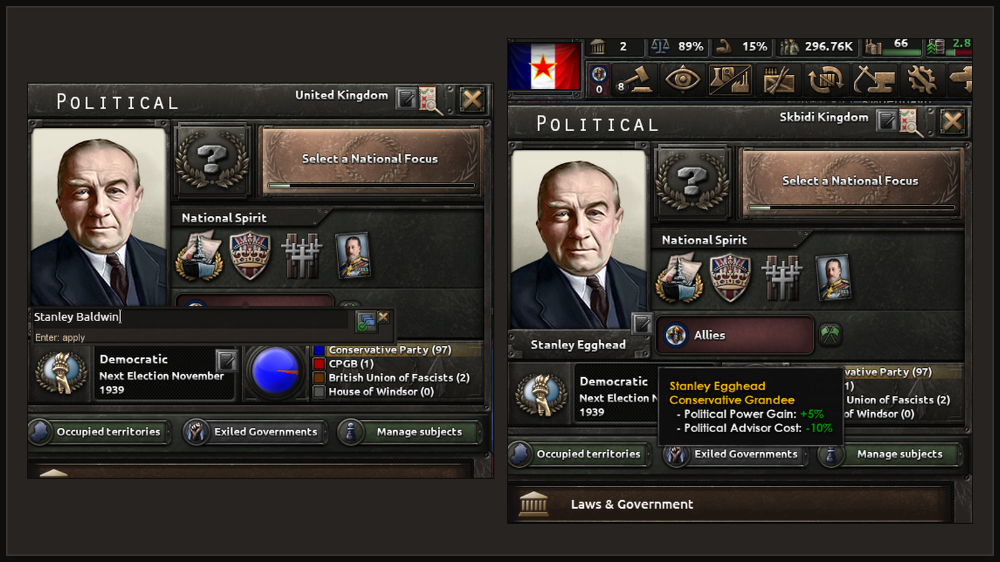
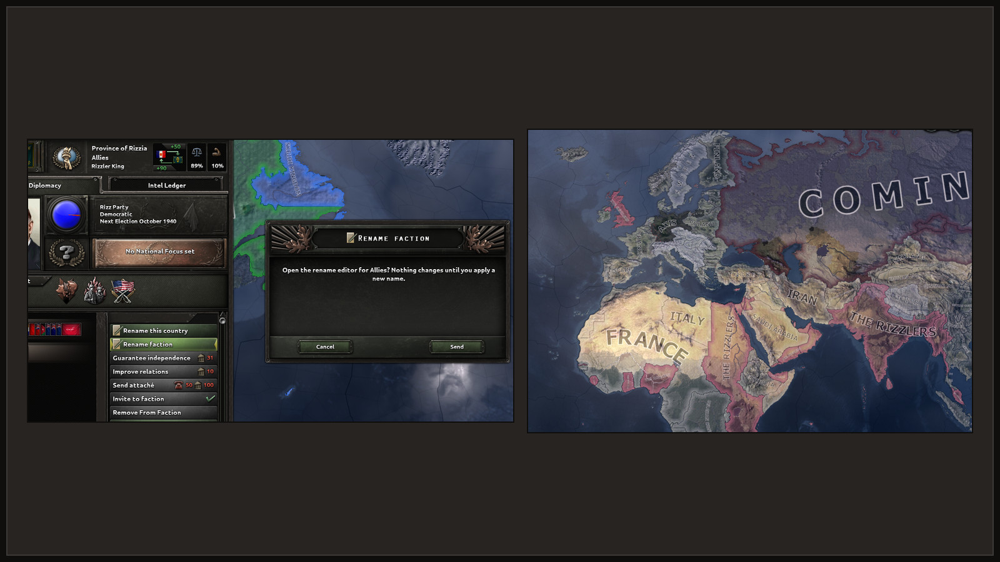

# How to use

You rename your country, leader and parties in the Politics panel, and your subjects and your
faction through diplomacy. States, cities and characters have their own editor. Each section says
whether it needs CAPIE.

## Your leader

1. Open the Politics panel.
2. Click the small pencil next to the leader's portrait. Its tooltip says "Rename leader".
3. The game's own text field opens in the same place, filled in with the current name.
4. Type the new name and press <kbd>Enter</kbd>, or click the Apply icon.

The name under the portrait changes at once. Needs CAPIE, because a script cannot read what you
type into the game's text field.

<figure class="diagram" markdown="span">
  
  <figcaption>Left: the text field opened under the portrait. Right: the panel after Enter.</figcaption>
</figure>

## Your parties

1. In the Politics panel, click the pencil for parties ("Rename parties").
2. The editor has one tab per party group, like the game's own tabs. The tab's tooltip shows that
   party's current name. Pick the group you want; it does not have to be the party in power.
3. Fill in both fields, "Short name" and "Full name", and press <kbd>Enter</kbd>.

The new party name shows in the panel right away. Needs CAPIE. The ruling party has been checked
in the game; of the other groups, one has so far.

## Your country's name and adjective

1. Click the pencil on the Politics panel's title line ("Rename country").
2. Fill in "Name" and "Adjective". Both are required.
3. Press <kbd>Enter</kbd>.

The map, diplomacy, tooltips and events use the new name. Decision titles keep the text they
were written with. Your flag and colour stay as they are: the name you give is kept on its own,
apart from the game's cosmetic tags. If the game later gives your country a new cosmetic tag (for
example through a focus), your name still shows.

In progress To go back, click "Restore name" in the same
editor. The country shows the name the game would give it now. Restoring counts as a rename for
the cooldown.

Needs CAPIE in every game session. Without CAPIE your country shows the game's name, and your
name comes back when you start the game with CAPIE again.

<figure class="diagram" markdown="span">
  
  <figcaption>The country editor: name and adjective on the Name tab, the flag picker on the Flag tab (in progress, needs CAPIE 1.4).</figcaption>
</figure>

## Your subjects

As an overlord you can rename your subjects.

1. Select the subject on the map and open its Diplomacy tab.
2. Take the action "Rename this country". It costs nothing and needs no answer.
3. The editor has three tabs: "Country" (name and adjective), "Leader", and "Party" (the ruling
   party's short and full name).
4. Fill in the fields and press <kbd>Enter</kbd>.

The action appears only for your own subjects, unless the host chose a different
[game rule](game-rules.md). Needs CAPIE.

<figure class="diagram" markdown="span">
  
  <figcaption>The subject editor opened from Diplomacy, over the British Raj.</figcaption>
</figure>

## Your faction In progress

The leader of a faction can rename it: the action "Rename faction" appears on the other members
of your faction in Diplomacy. This needs CAPIE 1.4, which so far exists only as a developer build
and was checked once in the game. With an older CAPIE the editor opens but says that faction
names need a newer CAPIE, and nothing changes.

<figure class="diagram" markdown="span">
  
  <figcaption>Rename faction in Diplomacy, and the renamed faction in the faction map mode (CAPIE 1.4 developer build).</figcaption>
</figure>

## States and cities

You can rename your own states and the cities (victory points) in them. No CAPIE is needed.

- Select one of your states on the map. Next to the game's state panel a small "Rename" panel
  appears with "Rename state", "Cities" and "Reset".
- "Cities" lists the victory points of that state; pick one and rename it. The list shows
  "Original (now New name)" for a city you renamed.
- The same lists are in the name editor, on the "States" and "Cities" tabs.

<figure class="diagram" markdown="span">
  
  <figcaption>New names on the map: a renamed country on the left, a renamed city on the right.</figcaption>
</figure>

## Generals, admirals and advisers

Open the decisions, find the "Rename Anything" category, and take the decision "Rename
characters". It opens the name editor on the "Characters" tab, where you pick a character from
the list and type a new name. States and cities are in the same editor. No CAPIE is needed.

With CAPIE loaded, the name editor uses the game's own text field. Without CAPIE it has an
on-screen keyboard: letters, <kbd>Shift</kbd> + letter for capitals, digits, `-` and `.`;
<kbd>Backspace</kbd> deletes and <kbd>Enter</kbd> applies. Polish letters and `'` are on buttons.
Game hotkeys stay active while you type there.

## Limits and checks

- At most 32 characters per name. Longer input is rejected with a red line under the field, and
  nothing is changed. Nothing is cut short.
- Letters, digits, space, `-`, `.`, `'` and the Polish letters ą ć ę ł ń ó ś ź ż (and capitals).
  Other letters, such as é, are rejected with a message.
- An empty field is rejected.
- Renames have a 5-day cooldown per object. While it runs, the pencil is greyed out and its
  tooltip adds a red line such as "Next rename possible in 3 days (last change: 4 January
  1936)." For states and cities the editor says "You can rename one state every 5 days" (or
  city).
- Who may rename what depends on the [game rules](game-rules.md). By default you rename your own
  country and your subjects.

## Where the names live

Every name is stored in your save, like any other change in the campaign. It survives saving,
loading and restarting the game.
