# Rename Anything

Built on CAPIE

Click the pencil next to a name, type a new one, press Enter. Rename Anything lets
you rename your country, its leader, its parties, its states and its cities in Hearts of Iron IV,
in the panel where the name is shown. As an overlord you can rename your subjects too.

!!! warning "Pre-release"

    Rename Anything is not on the Steam Workshop yet. The features marked
    Works today were checked in the game on development builds,
    single player, HOI4 1.19.3.0. Multiplayer is not supported.

HOI4 lets you name a division whatever you like, but your own country, its leader and its ruling
party are stuck with whatever the game or a focus tree gives them. Rename Anything gives you a
real text field instead: any name you can type, Polish letters included, saved in your campaign.

<figure class="diagram" markdown="span">
  
  <figcaption>Edit where you see the name. The new name is written into your save like any other change.</figcaption>
</figure>

## What you can rename

<ul class="st-legend">
  <li>Works today checked in the game</li>
  <li>In progress built, not yet checked or not finished</li>
  <li>Planned decided, not built</li>
  <li>Not supported do not rely on it</li>
</ul>

| Object | Where | Status |
|---|---|---|
| Your country's name and adjective | Pencil on the Politics panel title | Works today needs CAPIE; flag and colour stay |
| Your country's leader | Pencil next to the portrait in the Politics panel | Works today |
| Your ruling party, short and full name | Pencil in the Politics panel | Works today |
| Parties of the other ideology groups | Same editor, one tab per group | In progress two of four groups checked |
| States | State view on the map, or the name editor | Works today |
| Cities (victory points) | "Cities" in the state view, or the name editor | Works today |
| Generals, admirals, advisers | The name editor, from the decision "Rename characters" | Works today |
| Your subjects: name and adjective, leader, ruling party | Diplomacy, action "Rename this country" | Works today needs CAPIE |
| Back to the game's country name | "Restore name" in the country editor | In progress |
| Your faction's name | Diplomacy, action "Rename faction" | In progress needs a newer CAPIE |
| Your country's flag | | Planned |

Names survive saving, loading and a full restart of the game. Map labels, diplomacy, tooltips
and events pick up a new country name; decision titles keep their own text.

The host can also set two [game rules](game-rules.md) in the lobby: who may rename what, and
whether a renamed country makes the news.

## What needs CAPIE

Rename Anything is ordinary HOI4 script and interface files. Some things need more than script
can do, and those come from CAPIE (Cyprian's API Extender), a small native library:

- your country's and your subjects' names and adjectives, because the game has no script effect
  that takes free text for a country;
- the in-panel text fields, because a script cannot read what you type into the game's own text
  field;
- updating the leader's name in the open Politics panel at once.

States, cities and characters work without CAPIE, through the name editor and its on-screen
keyboard. Without CAPIE the pencils that need it are hidden and your country shows the game's
name.

[How to use it](how-to-use.md){ .md-button .md-button--primary } [Install](install.md){ .md-button }

Po polsku: [Rename Anything po polsku](pl/index.md).
