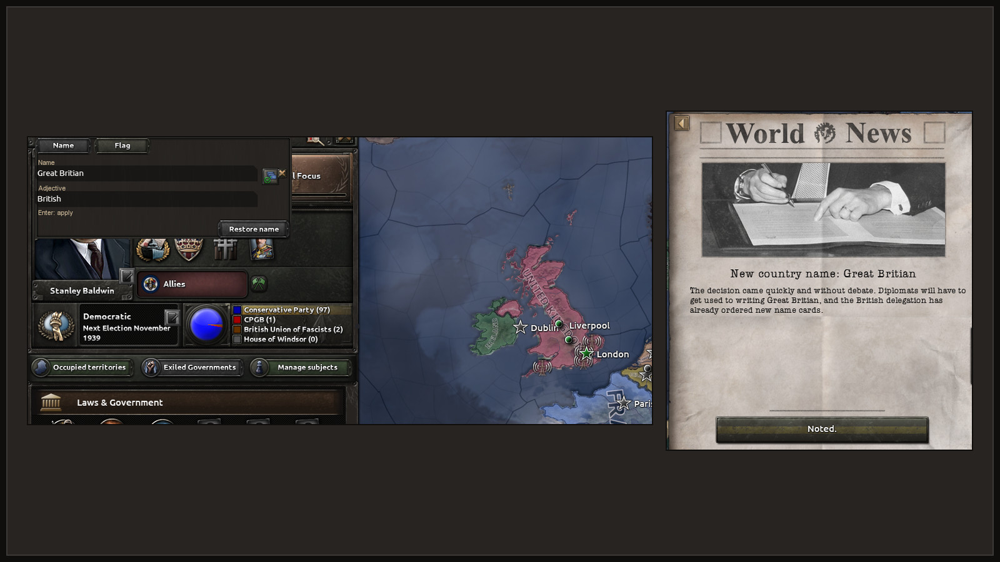

# Reguły gry

Host ustawia je w lobby, w regułach gry, jak każdą inną regułę. Każda reguła Rename Anything
zaczyna się od „Rename Anything:”, więc na liście są obok siebie. Z nowymi funkcjami dochodzą
nowe reguły; ta strona grupuje je według tego, o czym decydują.

Same reguły nie blokują osiągnięć; mod i tak zmienia sumę kontrolną gry (zobacz
[FAQ](faq.md#osiagniecia)).

## Kto może zmieniać nazwy W przygotowaniu { #rights }

„Rename Anything: kto może zmieniać nazwy”. Jest w modzie; jeszcze niesprawdzone w grze.

| Opcja | Znaczenie |
|---|---|
| Własne państwo i podmioty (domyślnie) | Gracze zmieniają nazwy swojego państwa i swoich podmiotów. Lider frakcji zmienia nazwę frakcji. |
| Host zmienia nazwy wszystkich państw | Jak wyżej, a host może zmieniać nazwy wszystkich państw i wszystkich frakcji. |
| Tylko własne państwo | Gracze zmieniają tylko nazwę swojego państwa, nie podmiotów. Lider frakcji nadal zmienia nazwę frakcji. |

Gra nie potrafi powiedzieć skryptowi, kto jest hostem. W grze jednoosobowej hostem jesteś ty. W
grze wieloosobowej opcja dla hosta nic nie robi, dopóki CAPIE nie będzie umiało zgłosić, kto jest
hostem.

Jeśli reguła nie pozwala na zmianę nazwy, edytor mówi „Ustawienia gry nie pozwalają zmienić tej
nazwy. Nic nie zmieniono.”

## Wiadomość o nowej nazwie państwa Działa dziś { #news }

„Rename Anything: wiadomość o nowej nazwie państwa”. Sprawdzone w grze na wersji rozwojowej CAPIE.

| Opcja | Znaczenie |
|---|---|
| Wyłączone (domyślnie) | Nazwy państw zmieniają się po cichu. |
| Włączone | Każdy dostaje wydarzenie z wiadomością, gdy gracz zmieni nazwę państwa albo przywróci jego pierwotną nazwę. |

Gdy poprzednia nazwa jest znana, tytuł wydarzenia brzmi „*stara nazwa* zmienia nazwę na *nowa
nazwa*”. W przeciwnym razie: „Nowa nazwa państwa: *nowa nazwa*”. Tekst to jedna z 4 krótkich
relacji, które wspominają stolicę, przywódcę albo przymiotnik. Zamykasz je przyciskiem
„Przyjęto do wiadomości.”

<figure class="diagram" markdown="span">
  
  <figcaption>Państwo przemianowane na Great Britian i wydarzenie, które dostaje każde państwo.</figcaption>
</figure>

## Wybór flagi { #flags }

„Rename Anything: wybór flagi” decyduje, jakie flagi gracz może dać państwu.

| Opcja | Znaczenie |
|---|---|
| Wszystkie flagi z gry (domyślnie) | Dowolna flaga z gry. Podmiot może też przyjąć obecną flagę zwierzchnika. |
| Flagi tego państwa | Tylko flagi samego państwa: jego ideologii i innych form państwa. |
| Flagi państwa i zwierzchnika | Jak wyżej, a podmiot może też przyjąć obecną flagę zwierzchnika. |

## Wyłączanie funkcji W przygotowaniu { #switches }

Każda funkcja ma własną regułę „Włączone” albo „Wyłączone”, na przykład „Rename Anything: Nazwa
i przymiotnik państwa”, „Rename Anything: Imię przywódcy”, „Rename Anything: Nazwy partii” czy
„Rename Anything: Nazwy frakcji”. Domyślnie wszystkie są włączone. Gdy host wyłączy jedną z nich,
jej przyciski zostają widoczne, ale szare, a podpowiedź mówi, że host wyłączył ją w tej grze. Jest
w modzie; jeszcze niesprawdzone w grze.

## Portret przywódcy W przygotowaniu { #portrait }

Wybór innego portretu przywódcy państwa jest w przygotowaniu. Dostanie własne reguły: jakie portrety są
do wyboru oraz czy portret przywódcy podmiotu może zmieniać zwierzchnik, podmiot czy obaj.
Wyłącznik tej funkcji jest już na liście; jego opis mówi, że wybór portretu przyjdzie w
późniejszej wersji.
